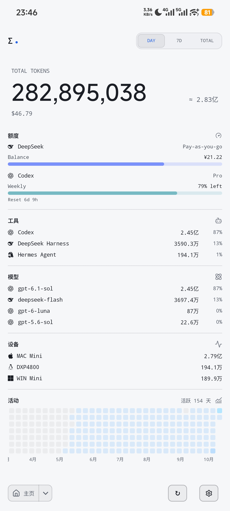
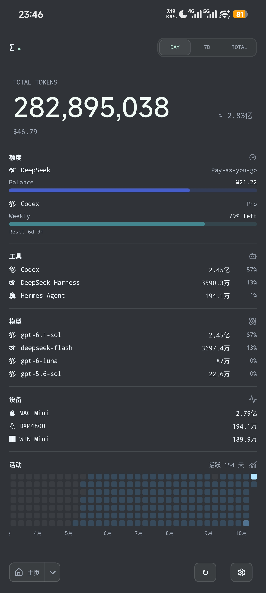
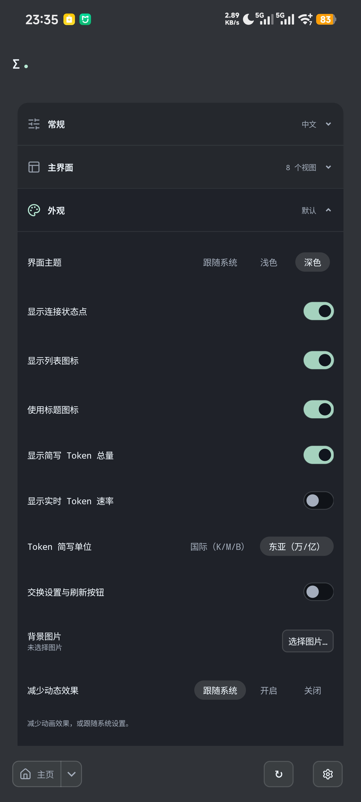

# Token Monitor Android

在手机上查看各台设备的 AI 用量、费用、额度和会话活动。

**Token Monitor Android** 是 [Token Monitor](https://github.com/Javis603/token-monitor) 的 Android Hub 查看客户端，使用 Kotlin 与 Jetpack Compose 实现。连接已有 Hub，即可集中查看桌面设备同步的统计数据。

[下载最新版 APK](https://github.com/Gott-mit-Uns/token-monitor-android/releases/latest) · [全部版本](https://github.com/Gott-mit-Uns/token-monitor-android/releases) · [来源与许可](THIRD_PARTY_NOTICES.md)

0.2.64 / 73 已合入主线并[正式发布](https://github.com/Gott-mit-Uns/token-monitor-android/releases/tag/v0.2.64)：按用户实际试用反馈彻底移除 Android 桌面小组件及常规相关设置，多设备同步的采集设备改为等宽两列。关于应用四入口、双协议地址与真实连接端点、设备信息和已有主页／趋势／额度／缓存功能保留。APK 为 15,238,142 bytes / 14.53 MiB，沿用原包名和正式签名；四个附件及公开 APK／校验文件均完整下载核对。验收边界见[当前交接](docs/HANDOFF_0.2.64.md)，发布指纹见[发布回执](docs/GITHUB_PUBLICATION.md)。手机由用户自行安装，NAS 未修改；本次没有合入 R8／资源瘦身实验。[包体积对比](docs/APK_SIZE_COMPARISON_064.md)和[后续优化提示词](docs/APK_SIZE_OPTIMIZATION_PROMPT.md)已另存。

0.2.63 / 72 为历史候选，小组件重新对齐在用户试用后取消，其桌面小组件功能已于 0.2.64 删除；本轮保留关于应用和多设备同步改进。历史调查及测试见[0.2.63 交接](docs/HANDOFF_0.2.63.md)及[Mac/Android 对照](docs/MAC_ANDROID_WIDGET_COMPARISON_063.md)。

0.2.62 以固定桌面 v0.70.0 为参考，新增可选逐位滚动动画，优化大量会话的近期选择和标题展示，集中外观高级选项，并支持 Hub 已上传的 CatPaw 用量及 MiniMax 本币余额。采集、计费、模型修正和额度刷新依赖 Hub／Agent；真实新供应商数据与实体手机网络仍未验证，见[本轮交接](docs/HANDOFF_0.2.62.md)。

0.2.61 增加关于页 Android 自身更新入口、只读缓存额度小组件，以及 Dashboard/记录日图的长按拖动逐日查看。设置开关支持短过渡，普通设置下拉更紧凑，字体菜单可直接选用已有的 Inter + Noto Sans SC 和 JetBrains Mono。小组件标注缓存时间与过期信息，点按后在 App 前台刷新；下载与安装交给浏览器和 Android 系统。具体范围与验收边界见[联合更新交接](docs/HANDOFF_0.2.61.md)。

## 界面预览

### 主页

<table>
  <tr><th>浅色主题</th><th>深色主题</th></tr>
  <tr>
    <td></td>
    <td></td>
  </tr>
</table>

### 设置



以上图片由用户提供，展示手机上的实际主页与设置；原图保留，未重绘。截图为 0.2.56 的实际使用界面，后续版本的布局调整请以安装版本为准。

## 重点功能

- **用量与费用总览**：查看 Token 总量、费用，以及 Hub 提供的输入、输出和缓存明细；支持不同统计周期与精确数值查看。
- **多维度明细**：按工具、模型、会话、项目和设备查看用量与费用，支持搜索、排序及相关详情。
- **历史趋势与 Dashboard**：查看历史曲线、柱图、活动热图和全时摘要，探索模型与工具的用量分布。
- **账户额度与订阅**：展示 Hub 提供的额度窗口、重置时间、账户状态和订阅信息，包括支持的双周期额度。
- **实时同步与离线缓存**：应用在前台通过 SSE 接收 Hub 更新；连接中断时保留最后有效数据，重新进入前台后恢复同步。
- **适合手机的个性化界面**：支持浅色、深色与系统主题，中英文，字号与数字字体，内置离线 Inter/Noto 常用中文界面字体和 JetBrains Mono 数据字体，主页模块显隐和顺序，以及减少动态效果设置。
- **连接信息透明可见**：配置 Hub 地址，在关于页查看 Android 版本、桌面参考范围，以及已验证读取的 Hub 构建信息。

数据和可用功能取决于 Hub 及其连接设备提供的内容。缺失字段保留未知状态，不补造用量或额度。

## 安装与连接

1. 从 [GitHub Releases](https://github.com/Gott-mit-Uns/token-monitor-android/releases/latest) 下载正式 APK；需要时使用同一 Release 的 `SHA256SUMS.txt` 核对文件。
2. 在 Android 8.0 或更高版本的设备上安装。
3. 打开应用，在连接设置中填写已有 Token Monitor Hub 地址及其所需认证信息。
4. 连接成功后，查看主页及工具、模型、会话、项目、设备、额度和趋势页面。

支持局域网 HTTP 和公网 HTTPS。双入口需由用户明确关联并验证后启用 LAN 优先与网络故障回退；认证和证书错误会保守处理。HTTPS 使用正常证书校验。

后续正式版沿用同一包名和签名，可覆盖升级。早期 Debug 开发包与正式版签名不同，不能直接覆盖；有数据的旧安装请先安排迁移，勿通过卸载或清空数据绕过签名问题。详见 [签名与升级说明](docs/RELEASE_SIGNING.md)。

### “设置—工具”的用途

这里调整手机上工具页的列表显隐、置顶、排序与搜索，并提供 Hub 模型规则和价格表入口。设置保存在本机，不配置或启动 AI 工具，也不改变 Hub 的统计总量；主页排行榜仍保留来源数据的排名。

## 工作方式与隐私

```text
桌面设备上的 Token Monitor / Agent
                ↓ 同步统计
          Token Monitor Hub
                ↓ HTTP / SSE
          Token Monitor Android
```

Android 客户端读取 Hub 数据，本机不扫描 AI 工具日志、不采集本机 Token，也不承担后台 Agent 的工作。连接信息及缓存通过现有加密存储保存；应用退到后台后关闭常规 HTTP/SSE 连接。

本项目以桌面端的显示语义为参考，针对手机触控和屏幕宽度适配。桌面参考版本与具体实现范围单独记录，不代表所有桌面能力均已移植。真实手机、蜂窝网络和生产端新增字段的验收范围见 [最新交接](docs/HANDOFF_0.2.64.md)。

## 开发

- Kotlin + Jetpack Compose，单 `app` 模块。
- JDK 17、Android SDK 37，使用项目自带 Gradle Wrapper。
- 最低 Android API 26；`applicationId` 为 `dev.bing.tokenmonitor.nativeclient`，保留既有升级标识。

```sh
./gradlew :app:assembleDebug :app:testDebugUnitTest :app:lintDebug
```

正式构建需要仓库外安全配置的既有签名，详见 [RELEASE_SIGNING.md](docs/RELEASE_SIGNING.md)。

[架构说明](docs/ARCHITECTURE.md) · [Hub 合同](docs/HUB_API_CONTRACT.md) · [功能范围](docs/FEATURE_MATRIX.md) · [上游追溯](docs/UPSTREAM_SYNC.md) · [后续任务](docs/NEXT_TASKS.md)

## 来源与许可

上游项目为 [Javis603/token-monitor](https://github.com/Javis603/token-monitor)，采用 MIT 许可证。本客户端以 Kotlin/Compose 独立实现，未引入先前 Android fork 的业务源码；直接使用或改编的资源及相关归属保留在 [来源说明](THIRD_PARTY_NOTICES.md)。

Lucide / Feather 图标及运行依赖的许可随 APK 打包，可在应用“来源与许可”中离线阅读；依赖清单见 [DEPENDENCY_LICENSES.md](docs/DEPENDENCY_LICENSES.md)。本项目原创代码目前未单独指定公开源代码许可证，上游许可不自动替代本项目的许可决定。
