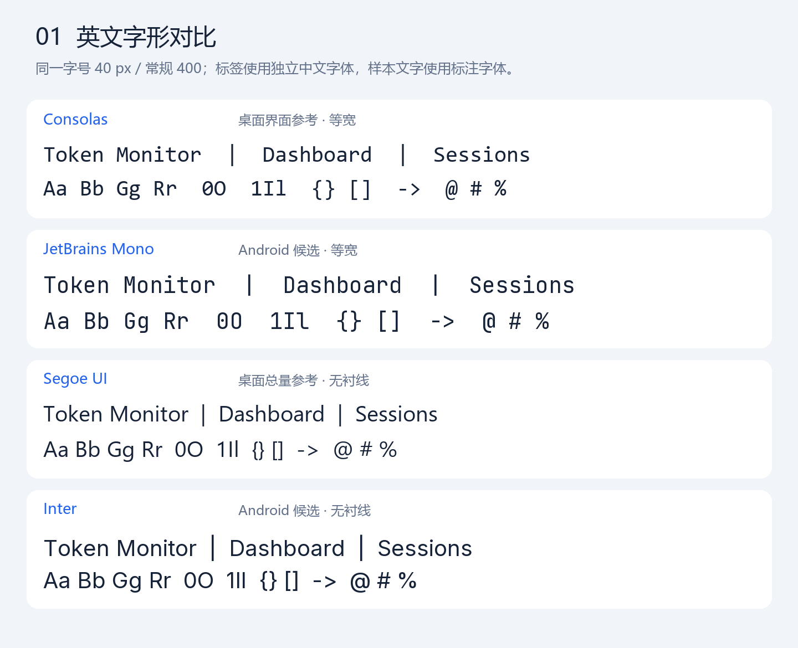
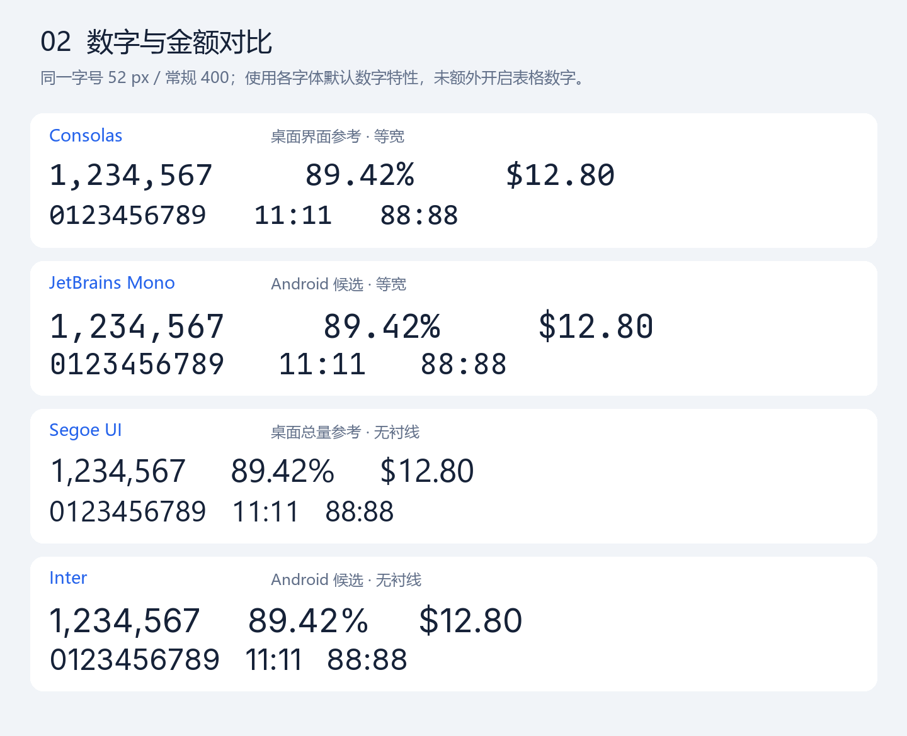
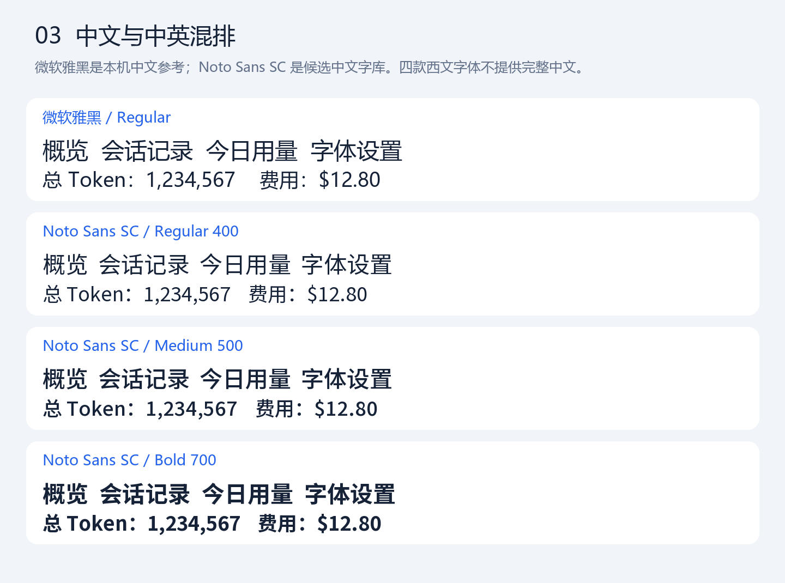

# 字体设计资源与预览

本目录保存原始设计字体、许可证、来源指纹和本机渲染预览；位于Android资源目录之外，不会因放在这里而进入APK，不要整目录复制到app资源。

预览由实际字体文件以相同字号渲染，本机栅格化不替代Android截图验收。Inter用于界面与总量，JetBrains Mono用于对齐数据，Noto Sans SC用于中文；运行时使用派生Token UI/Token Data，完整Noto原始设计源不打包。字体原始SIL OFL许可证位于fonts，来源和指纹见manifest.json；Consolas、Segoe UI、微软雅黑仅为本机视觉参考，文件未入库。

维护时保留用户自定义/系统字体与可靠系统后备，覆盖中英混排、金额、生僻动态名称和大字，不按固定界面文案切掉必要字形。新增字体预算为同源码同构建配置的正式APK增量不超过5,000,000 bytes，压缩估算不替代实际差分。当前验收只见[VALIDATION](../../docs/VALIDATION.md)，接续与限制只见[HANDOFF](../../docs/HANDOFF.md)，不在此追加发布流水。
