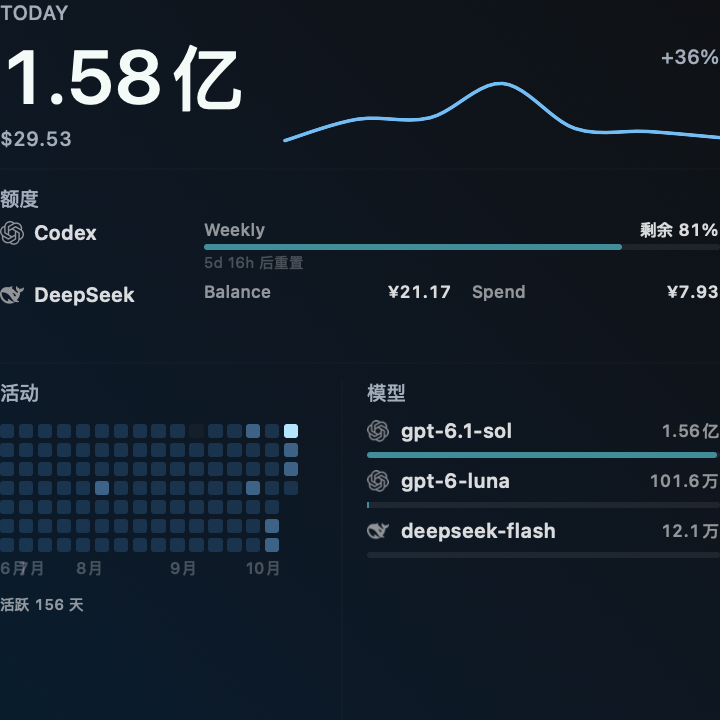
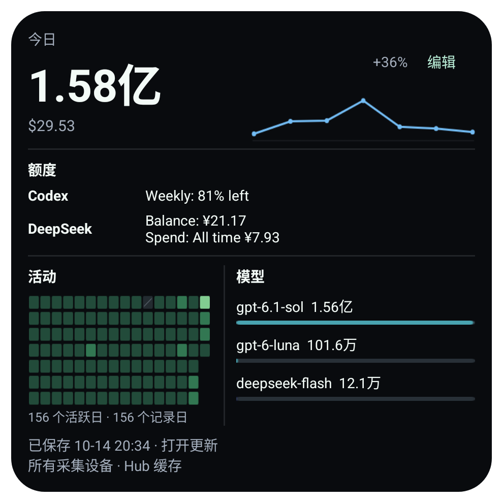

> 历史对照：用户已取消 Android 桌面小组件，0.2.64 删除此功能。本文保留 REA/源码/现场的历史证据，不是当前版本功能承诺；见 [当前交接](HANDOFF_0.2.64.md)。

# Mac 系统 Widget 与 Android 0.2.63 对照

参照为本机已安装 Token Monitor 0.70.0 arm64 的 WidgetKit 扩展，UI 47 / schema 10 / revision `ac4eeb2c4aea239dd94b67f074c73f69aafc46f8`。用户明确选择“编辑小组件”添加的系统桌面 Widget。Edge Dock、悬浮窗、迷你窗口和主界面卡片不属于本次 Widget 参照。

证据类型：**观察**指实际运行界面；**REA**指对已安装工件的真实分析调用；**源码**指该工件准确构建 revision 的定向代码辅证；**同输入预览**指原 Mac SwiftUI 组件读取授权脱敏快照的导出图，不能冒充系统桌面截图；**待验收**表示没有实际验证。Android 最终执行结果见 [统一交接](HANDOFF_0.2.63.md)。

| 项目 | Mac 参照及依据 | Android 实现及差异 |
| --- | --- | --- |
| 系统尺寸 / 内容 | Dashboard large；Summary small；Activity、Breakdown、Quota medium。源码 `TokenMonitorWidget.swift`；实际观察到 Dashboard | 保留两个原 provider，RemoteViews 用量支持 Summary、Dashboard、Activity、Tools、Models；额度独立。实际可用 dp 由 Launcher 决定，不能把 WidgetKit family 当作固定像素 |
| 配置 | 三周期；Breakdown tools/models；Dashboard 两种分解及自动/最多两额度；Quota 自动/最多两额度。源码配置 Intent；实际编辑菜单未完成核对 | 每实例周期、模式、分解、自选额度独立保存，取消不落盘；旧实例无配置时仍显示今日摘要/自动额度。没有编造设备筛选 |
| 字段 / 归属 | Tokens、usage cost、趋势、活动、工具/模型、额度窗口/余额/Spend。实际 Dashboard 观察与源码一致；Mac 快照来自其当前数据路径，没有 Widget 单独 device selector | Hub 缓存权威值；用量标明全部 Hub 采集设备，额度归属真实账户。手机不采集，不把手机联网状态当采集设备在线 |
| 周期 | day/month/total 映射 today/month/allTime；月为自然月。REA 原生 entry 确认 selecting(period)，JS 与源码确认字段 | 今日/自然月/全部，独立于 App 的 last30 偏好；长数字保留精确无障碍说明 |
| 单位 / 币种 | localized 万/亿或 K/M/B；usage cost 按 currencyRate，两位小数；余额按供应商币种。源码与同输入预览 | 复用语言、单位与汇率设置；usage 与 quota 币种独立。未知 `—`，真实 0 显示 0 |
| 趋势 / 活动 | 今日最近七日、月截至今日、全部逐月；history/live 取最大值；活动最近 182 日、四级强度。JS 定向 REA + 源码 | 同统计范围和 max 合并，不重复累计。缺失 Hub 日保留缺口；Mac 源码缺日填 0 的行为不用于伪造 Android 已知数据 |
| 视觉层级 | 主数居首，顶部趋势、中部额度、下方活动左列/分解右列；深底、浅色主数、低对比次文、绿色强调。源码；实际桌面因系统着色呈灰色 | Dashboard 相同信息组织；原生浅/深色适配。正常尺寸适配大字体；旧小尺寸字体 2 不能同时容纳主数和操作时，显示真实状态与扩大提示，隐藏主数/费用；不承诺像素一致 |
| 字体 / 图标 / 留白 | SwiftUI 字体和供应商资源，dashboard 主数 42pt、分区约 10pt；渐变和系统 Widget 外框。源码 | Android sp 随系统字体，长数测量适配，已有供应商资源，紧凑留白。48dp 操作；系统外框、字体渲染和主题着色有平台差异 |
| 点击 | 原生 Refresh 调用 reloadAllTimelines，实际点击后没有主窗口导航；热图日期选择/清除为 AppIntent 源码辅证，未实际核对 | 摘要/Dashboard→Home，Tools/Models→相应页面和实例周期，Quota→Limits，Activity→Trends。细格日期交互由 App 原生趋势页替代；实例 PendingIntent 不共用 |
| 数据 / 缓存 | AppGroup snapshot.json → Data → JSONDecoder；REA 原生有效结果。Electron 主应用负责写快照，refresh 这段原生 body 不联网 | 原加密 HubStore 只读业务缓存；App 前台 HTTP/SSE 保存触发重绘，Widget 不建立网络连接 |
| 刷新 | REA timeline 请求 900 秒后刷新，系统不保证准时 | Android 30 分钟系统缓存重绘 + 保存/偏好/开机/升级事件，不用高频轮询或常驻服务模拟实时 |
| 空 / 加载 / 异常 | 源码 Waiting for data/Open Token Monitor once，preview 才示例；REA 读失败 optional nil；运行空态未实测 | 无缓存显示等待，失败保留有效缓存并提示；损坏缓存不显示成 0。配置异步读取不阻塞主线程 |
| 离线 / 过期 | REA content 判断源 stale 或 1200 秒龄后进入状态视图；实际过期转变未录制 | 保留可信数字、源时间和过期/离线状态。Widget 无网络探测，不能声称后台仍连接；打开 App 更新 |
| 生命周期 | WidgetKit 管理宿主；删除/重启未实际观察 | 原 provider/package/signature 保留，按 id 删除、恢复及缓存重绘；模拟器 host、真实 Launcher、覆盖升级、真机分别记录 |

旧实例可能保留小于新版推荐尺寸的宿主配置。Android 在有效高度不足时移除重复周期行和单独 Open 行，整个组件仍可点击，Edit 保留 48dp；旧 160dp/正常字体须保留主数、费用与可信缓存状态。系统字体 2 且高度小于 240dp 时，核心数字和 48dp 操作无法同时完整容纳，显示真实缓存状态与扩大提示，保留配置和点击路由，不把被隐藏的未知读数显示为 0。该尺寸限制和实际字体/桌面表现须分别验收。

## 同一输入的可核对数字

仅通过 Finder 读取用户单独授权的那一份 `snapshot.json`。临时原始副本在生成脱敏数据后删除；未更改 AppGroup、应用或全磁盘权限。授权数据的生成时间为 `2026-10-14T12:34:26.010Z`，源时间 `2026-10-14T12:34:24.968Z`。脱敏 fixture SHA-256：`0ee2a005fd0d7c796265d1bf78751b721beba2f8c69ce25857b78efe19274a20`。

| 周期 | 原始 Tokens | 原始 USD | 两端展示预期 |
| --- | ---: | ---: | --- |
| 今日 | 157509735 | 29.532795 | 1.58亿 / $29.53 |
| 自然月 | 3384895168 | 1077.315743 | 33.8亿 / $1077.32 |
| 全部 | 7434476736 | 2739.642454 | 74.3亿 / $2739.64 |

另核对 Codex 81%、DeepSeek 余额 ¥21.17、Spend ¥7.93、今日增长 +36%，以及每个已知趋势点。Android fixture 只包含需要的统计/历史/预期字段，账户身份替换为合成身份；没有录入生产凭据。

下列同输入原图已经保存，未重绘、裁切或改数。左图为**原 Mac SwiftUI 组件导出预览**，右图为**Android 真实绑定 AppWidgetHost 的 RemoteViews 截图**；它们不代表已在 Mac WidgetKit / 小米 Launcher 同步显示。

| 原组件 / 周期 | Mac source-derived 预览 | Android host 截图 |
| --- | --- | --- |
| Dashboard 今日 | [原图](images/widget-063/mac-source-derived-dashboard-day.png) | [原图](images/widget-063/android-host-dashboard-day.png) |
| Dashboard 自然月 | [原图](images/widget-063/mac-source-derived-dashboard-month.png) | [原图](images/widget-063/android-host-dashboard-month.png) |
| Dashboard 全部 | [原图](images/widget-063/mac-source-derived-dashboard-total.png) | [原图](images/widget-063/android-host-dashboard-total.png) |
| Summary 今日 | [原图](images/widget-063/mac-source-derived-summary-day.png) | [原图](images/widget-063/android-host-summary-day.png) |
| Summary 自然月 | [原图](images/widget-063/mac-source-derived-summary-month.png) | [原图](images/widget-063/android-host-summary-month.png) |
| Summary 全部 | [原图](images/widget-063/mac-source-derived-summary-total.png) | [原图](images/widget-063/android-host-summary-total.png) |

真实 Mac 现场另见 [系统 Widget](images/widget-063/mac-system-widget-live.png)、[关于](images/widget-063/mac-about-live.png)、[多设备同步](images/widget-063/mac-sync-live.png)。文件指纹和截图类别见 `images/widget-063/provenance.json`。

Mac 实际系统 Widget 截图在 `evidence/widget-settings-063/mac/dashboard-live.png`。再次解锁、实际点击 Refresh 后的 `mac/dashboard-refresh-repeat.png` 仍显示今日 2526.5万/$5.03、Codex 70%/68%、DeepSeek ¥27.70/¥1.40，与授权读取的当前 AppGroup 快照不一致。准确 revision 的 placeholder 是 2780万/$14.86 及另一组额度，因此不能把此画面称为该 revision 的示例，也不能证明 Refresh 已载入新数据。Apple `pluginkit` 只列出一个同 bundle ID 的 0.70.0 扩展，路径正是 `/Applications/Token Monitor.app/.../TokenMonitorWidget.appex`，登记证据为 `mac/registered-widget-plugin.txt`。旧 timeline/render 被系统保留是可能原因，**尚未确认**；本轮没有为取得同数截图而修改 Mac App、AppGroup 或 WidgetKit 注册。过期计算在一次 entry 渲染时使用 entry.date，也不能据墙钟过去 20 分钟就断言已经观察到 stale 切换。

准确源码同输入预览在 `evidence/widget-settings-063/mac-fixture-preview/rendered/`：六图由未修改的原 SwiftUI 组件解码同一 fixture，经 ImageRenderer 导出；来源、八个 Swift 文件指纹和限制见该目录 README。它保留真实组件内部布局，但不含 WidgetKit 外边距、外圆角、系统阴影，也没有向实际 AppGroup 写入测试数据。它用于统计和内部视觉对照，**不是实际系统 Widget 的同输入截图**。该实际同输入截图尚未取得，应作为明确待验收项保留。

## 关于应用与多设备同步

Mac 实际关于页观察到 GitHub、网站、报告问题、诊断及 MIT/版本信息。Android 本次对齐用户指定的四个**现有 Android 入口**：检查更新、当前版本说明、Android 发行页、来源与开源许可，保留各自行为和完整许可。正常宽度四列，窄宽或大字体两列；不凭 Mac 入口改名或删除 Android 更新功能。

Mac 多设备同步实际显示设备名、操作系统与版本、Widget/Agent 运行类型及版本、在线状态和同步时间。REA 提取的 `syncDevicePanel.js` 与实际界面相互核对：远端同步时间优先 receivedAt，缺失再 updatedAt。Android 已有 Hub `Device` 和构建模型包含所需字段，无需协议扩展或服务端改动；缺字段明确未提供/未知。手机查看端、Hub、采集设备分别展示；离线缓存标注上次报告。

Android 同时列出真实配置的 HTTPS 和 HTTP，缺失协议显示未配置；每行地址仅呈现 scheme/host/port，认证路径、查询参数等不进入展示。边框、背景与“当前使用”来自网络层接受的成功响应/SSE 端点，停止或失败清除当前，保留可选“上次连接”。移除旧切换按钮，配置、已有 LAN 关联验证与安全故障恢复仍保留；没有新增 HTTPS→HTTP 降级、证书绕过或全局明文许可。

Android 设置原图：[四入口正常宽度](images/widget-063/android-about-regular-light.png)、[大字体两列](images/widget-063/android-about-large-light.png)、[双地址与设备](images/widget-063/android-sync-live-light.png)、[离线上次连接](images/widget-063/android-sync-offline-light.png)。它们由同轮 fbff 产品包的设置专项生成；最终 f790 包的相关设置源码没有变化，按明确范围继承，不冒充最后包重跑截图。截图使用合成地址和设备信息；其输入与 Mac 生产同步页不同，仅核对字段语义和布局。

## REA 调查的有效调用与限制

真实使用 REA MCP/CLI 6.4.0。ASAR 原始 SHA `bc4e209f9f363789dd6c34789f9a1d8727e9fa20ae759e32339d5ed6ba7374eb`。严格读取先在三个 unpacked 原生依赖的完整性检查失败；改为显式 record-and-continue 静态提取，保留 mismatch，未执行这些依赖。完整大图预算不足后对 Widget 快照、bridge、sync 相关七模块定向分析：JS summary `ev_636b61ace32e7b145e2cca420c1e2efa80c50c3ef5a00bc3bba6772b1a22c830`，事件/数据 trace `ev_3ae0be104ac5e91677dd866128f15f191b7b45a590c9e7034f2532293cb97c24`，sync 模块 `ev_5c6c4056a770f39a33b8ee402f3378874cf222414a8cffe65e5a2eb4d4f85edd`。trace 是静态/推断边，不是运行调用日志。实际 `extract-artifact` 成功记录为 `ev_03f58fcd48475e11fd5f3694162b459a0c7f22ccc280d6c57fafde26380bf890`。

原生扩展经过 REA Ghidra 定向函数分析，真实确认共享快照读取/周期选择、Refresh、900 秒 timeline 和 1200 秒 stale 分支，地址、工具链、Evidence、失败及截断限制见 [原生逆向报告](REA_NATIVE_WIDGET_063.md)。REA Native UI 宿主因 xcrun 超时/NotificationCenter 稳定进程身份不可用未取得有效动态结果；未绕过身份检查，实际界面通过 CUA 核对并单独标注。配置菜单、热图日期行为与系统刷新准时性仍未运行验证。
