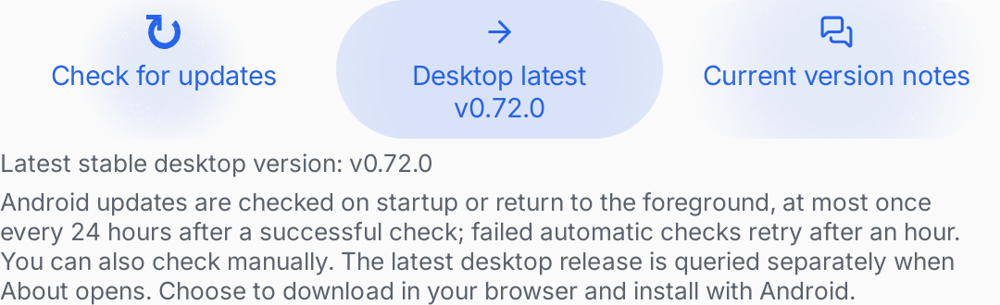
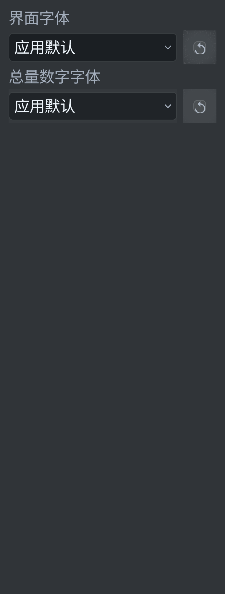
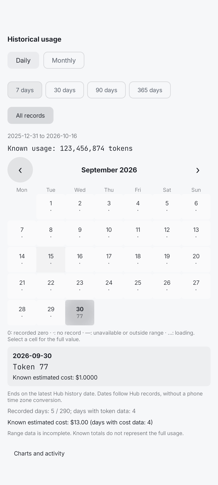
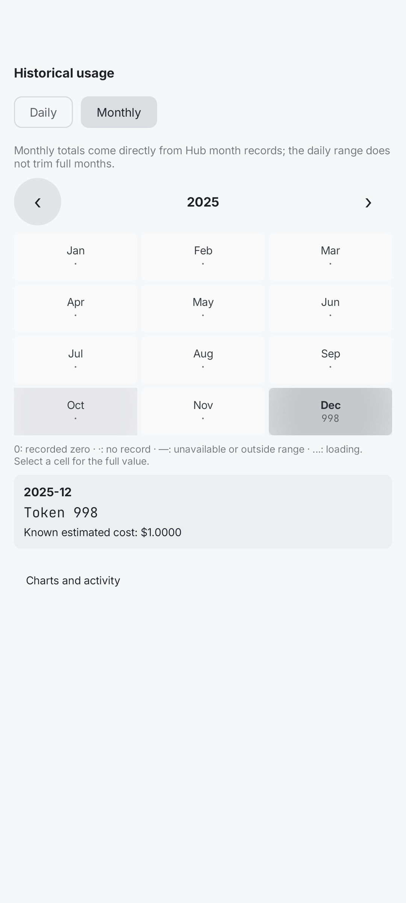
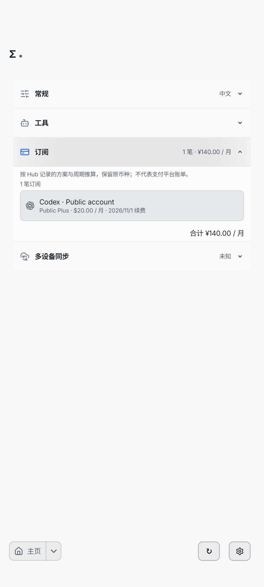
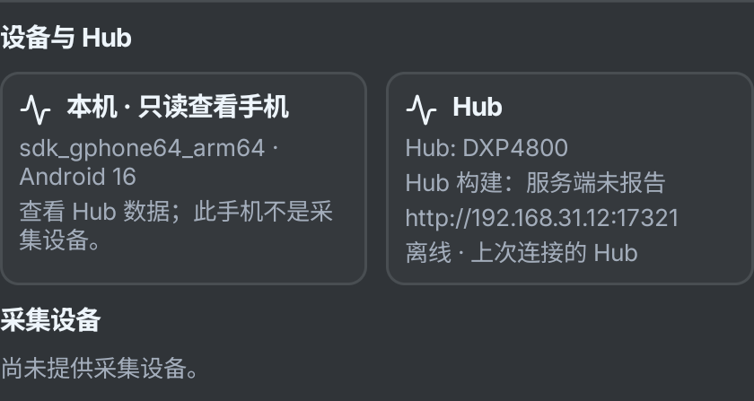
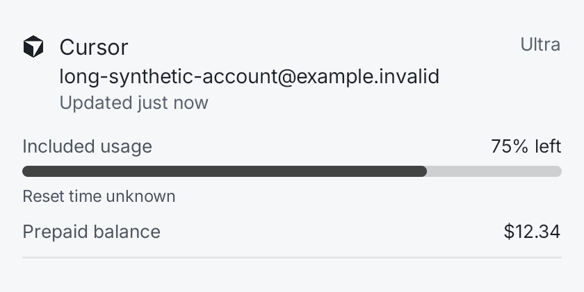
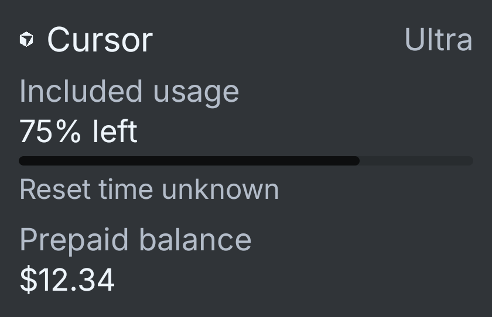
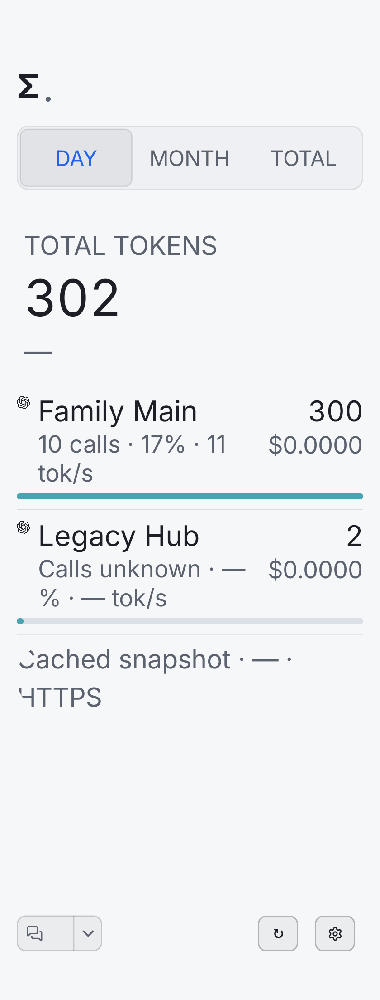
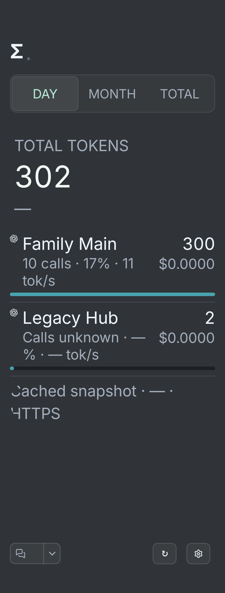

# Android 0.72.0-01 最终封包界面证据

下列原图来自API36模拟器的公开／合成fixture，关联生产APK SHA-256 `17b7470e0a52b23a5e624d88f66999f9a3f91197b0cc964edab814dc70ac1991`。本次78次专项按18＋54＋6三个独立批次实际执行通过；首次SharedData时钟域失败保留，最后6次使用仅注入测试时钟后的测试包（SHA `6439190bbc9a405a48b8bfca870ac2f77100acc9a29a419f5baec195f2354502`），其余72次测试包SHA为 `c116eb6e3b968b4ec183a6eba06efc478c75d082c8c143d8805aeadd17dfc200`，生产APK完全相同。图片不代表实体手机、真实Cursor账号或生产Hub数据，不修改像素。

当前仍为候选，公开Release／附件和Android新旧更新器读回未完成。最终包已通过明确opt-in冷主页及设置恢复检查；早先assumption跳过记录不计入通过。

图中Hub名称来自fixture；配套NAS PR #11未合并部署。只有明确标记的系统320dp/fontScale2图证明该系统配置，其他组件按各自测试设置宽度／字体。完整身份、两份测试APK及升级／冷启动边界见 [本轮交接](HANDOFF_0.72.0-01.md)。

## 关于页：前台更新说明与独立桌面查询

原始成功记录：`evidence/desktop-072/ui-joint-final/normal/false/compact-about-light.png`。

## 紧凑字体控件：320dp／fontScale2深色

原始成功记录：`evidence/desktop-072/ui-joint-final/normal/false/compact-fonts-dark-320-2.0.png`。

## 日历选日及明细口径

原始成功记录：`evidence/desktop-072/ui-joint-final/normal/false/compact-records-daily.png`。

## 月份网格及所选月合计

原始成功记录：`evidence/desktop-072/ui-joint-final/normal/false/compact-records-monthly.png`。

## 订阅已加载区：条目合计保留，刷新按钮移除

原始成功记录：`evidence/desktop-072/ui-joint-final-shared/normal/false/shared-subscriptions-light.png`。

## 深色Hub卡：修正主题背景，明确名称与离线状态

原始成功记录：`evidence/desktop-072/ui-joint-final-remaining/normal/true/settings064-sync-hub-explicit-name-offline-dark.png`。

## Cursor完整卡：Included usage与USD预付分离

原始成功记录：`evidence/desktop-072/ui-joint-final-remaining/normal/false/cursor-072-limits-light-1.0.png`。

## Cursor紧凑卡：深色fontScale2，余额无虚假百分比

原始成功记录：`evidence/desktop-072/ui-joint-final-remaining/normal/false/cursor-072-home-dark-2.0.png`。

## 会话指标：系统320dp/fontScale2，完整行宽及自然换行

原始成功记录：`evidence/desktop-072/ui-joint-final-remaining/system320-font2/false/sessions072-light-group.png`。

## 会话缺值：深色系统320dp/fontScale2，不伪造零值

原始成功记录：`evidence/desktop-072/ui-joint-final-remaining/system320-font2/false/sessions072-dark-missing.png`。
