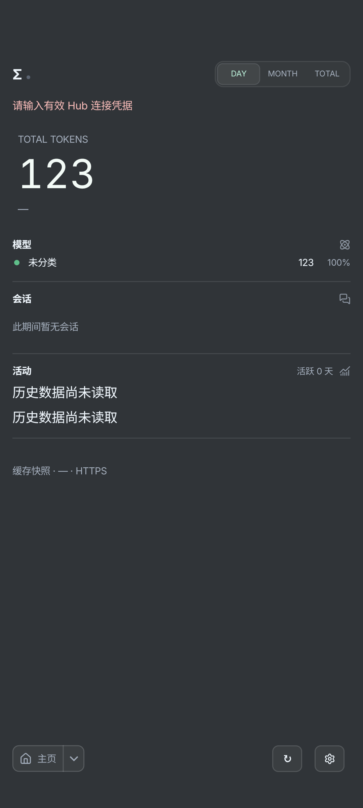
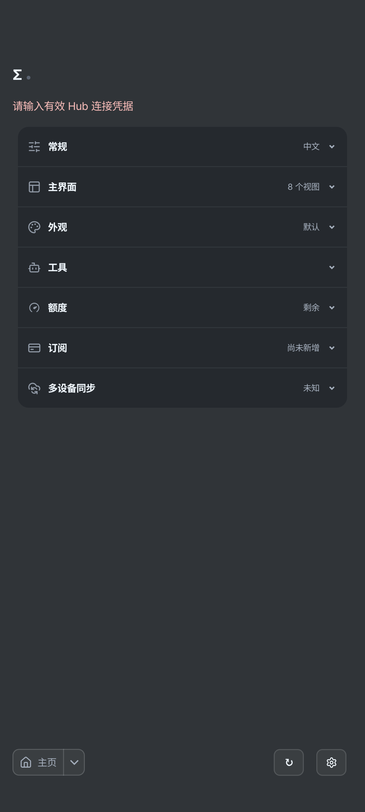

# Android 0.72.0-01：17b7视觉继承与db90实际冷启动截图

前10张原图均来自 **17b7候选** 的API36模拟器公开／合成fixture，APK SHA-256 `17b7470e0a52b23a5e624d88f66999f9a3f91197b0cc964edab814dc70ac1991`。该候选实际78专项分为18＋54＋6；前72次测试APK为 `c116eb6e3b968b4ec183a6eba06efc478c75d082c8c143d8805aeadd17dfc200`，后6次为 `6439190bbc9a405a48b8bfca870ac2f77100acc9a29a419f5baec195f2354502`，SharedData初始时钟失败保留。没有把截图重绘或重新标成新包截图。

随后自动审查P2由5b1fb38修复配置重建中的更新请求取消／重复请求问题，生产修改仅MainActivity／Model生命周期，视觉UI源未改。**最终候选现为db90（SHA `db90f7e985cfa14c9f799171c0e114228a3a369ccf55834ab89f602d13c2b977`），已完成514单元及受影响9＋2实际复验。** 本页17b7截图可作为未受影响视觉范围的继承证据，不能称新APK重新完成78或证明新生命周期逻辑通过。17b7自身opt-in冷启动／保留结果仍归其候选；db90已另有9项更新／版本／桌面查询／保留及2项opt-in冷主页／设置恢复回执。`ui-inheritance-proof.json` 证明生产main仅Activity／Model两文件生命周期变化，因此本页视觉继承不包含新生命周期逻辑的冒称。

图不代表实体手机、真实Cursor账号或生产Hub数据。Hub名称来自fixture；NAS PR #11现已合并并随NAS0.72.0-02发布，实际部署未验收。仅明确标记的系统320dp/fontScale2图证明该配置，其余按各自测试规定宽度／字体。正式Release／同字节兼容latest、全部8附件、新旧更新器及公开64→75→76升级／冷保留现已完成；实际最新状态见[联合交接](https://github.com/Gott-mit-Uns/token-monitor-android/blob/cfab5438ed5dac6537c68affb385517ccfa44c0e/docs/HANDOFF_0.72.0-01.md)。

## 关于页：前台更新说明与独立桌面查询

原始成功记录：`evidence/desktop-072/ui-joint-final/normal/false/compact-about-light.png`。

## 紧凑字体控件：320dp／fontScale2深色

原始成功记录：`evidence/desktop-072/ui-joint-final/normal/false/compact-fonts-dark-320-2.0.png`。

## 日历选日及明细口径

原始成功记录：`evidence/desktop-072/ui-joint-final/normal/false/compact-records-daily.png`。

## 月份网格及所选月合计

原始成功记录：`evidence/desktop-072/ui-joint-final/normal/false/compact-records-monthly.png`。

## 订阅已加载区：条目合计保留，刷新按钮移除

原始成功记录：`evidence/desktop-072/ui-joint-final-shared/normal/false/shared-subscriptions-light.png`。

## 深色Hub卡：修正主题背景，明确名称与离线状态

原始成功记录：`evidence/desktop-072/ui-joint-final-remaining/normal/true/settings064-sync-hub-explicit-name-offline-dark.png`。

## Cursor完整卡：Included usage与USD预付分离

原始成功记录：`evidence/desktop-072/ui-joint-final-remaining/normal/false/cursor-072-limits-light-1.0.png`。

## Cursor紧凑卡：深色fontScale2，余额无虚假百分比

原始成功记录：`evidence/desktop-072/ui-joint-final-remaining/normal/false/cursor-072-home-dark-2.0.png`。

## 会话指标：系统320dp/fontScale2，完整行宽及自然换行

原始成功记录：`evidence/desktop-072/ui-joint-final-remaining/system320-font2/false/sessions072-light-group.png`。

## 会话缺值：深色系统320dp/fontScale2，不伪造零值

原始成功记录：`evidence/desktop-072/ui-joint-final-remaining/system320-font2/false/sessions072-dark-missing.png`。

# 正式db90：实际MainActivity冷启动与后台返回

以下2张为正式db90实际运行的MainActivity截图，并非测试setContent重建页面。它们来自API36模拟器的默认公开合成缓存／空凭据场景，和前10张17b7视觉继承图分开记账；对应生产APK SHA-256 `db90f7e985cfa14c9f799171c0e114228a3a369ccf55834ab89f602d13c2b977`。原像素保持，不代表真实手机或已连生产Hub。首页保留合成123缓存、无效／未配置凭据提示与“历史数据尚未读取”，不以截图伪装在线或真实历史加载。

## db90实际冷启动主页：公开合成缓存123，未配置凭据与未读取历史明确呈现

原始证据：`evidence/desktop-072/release76/cold/screenshots/cold-process-actual-home-dark-chinese-public.png`；同名JSON保留在原始证据目录。

## db90设置页后台返回：真实MainActivity与合成fixture，未伪造连接状态

原始证据：`evidence/desktop-072/release76/cold/screenshots/cold-process-actual-settings-after-background-return-dark-chinese-public.png`；同名JSON保留在原始证据目录。
