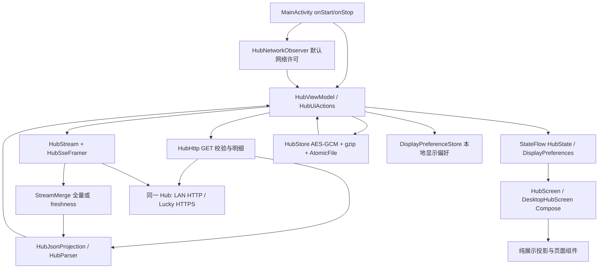

> 历史快照：文档整理前的原始阶段记录，不作为当前状态或执行授权。

# Android 架构与模块索引

2026-10-14 / 0.2.64 当前增量：Android 桌面小组件整体删除，两个 provider、配置 Activity、专属权限/布局/资源/刷新 hooks/入口/路由不再保留。常规只保留语言与关于等原有功能；`HubSyncDevices` 的采集设备按等宽两列自然排布，手机查看端与 Hub 角色仍明确区分。加密缓存与前台 HTTP/SSE 的职责不变。下面 0.2.63/0.2.61 小组件条目仅为已取消功能的历史记录，不能作为重新引入依据。验收见 [HANDOFF_0.2.64.md](HANDOFF_0.2.64.md)。

2026-10-14 / 0.2.63 候选增量：原 `.HubWidgetProvider` / `.HubQuotaWidgetProvider` 仍为 RemoteViews 缓存宿主。`WidgetConfigurationStore` 按 appWidgetId 保存独立模式、周期、分解及脱敏额度标识；配置 Activity 异步读取原加密 HubStore，取消不提交。`WidgetProjection` / `WidgetCharts` / `WidgetDashboard` 为纯缓存统计与布局，系统 updatePeriodMillis 改为 1800000（30 分钟）并保留保存、偏好、boot、package-replaced、restore 重绘；无 Widget 网络连接、轮询器或常驻服务。`MainActivity` 原入口追加实例/周期路由，隐藏页面仍可直接打开。`HubState.connectedEndpoint` / `lastSuccessfulEndpoint` 由接受的网络响应写入，停流/失败清当前，旧缓存无 receipt 保持未知；可选 receipt 仍在原加密 envelope，无 Hub wire 协议变化。`HubSyncDevices` 区分查看手机、Hub 和采集设备。详见[统一交接](../widgets/HANDOFF_0.2.63.md)。下面 updatePeriodMillis=0 是 0.2.61 的历史记录。

2026-10-13 / 0.2.61 增量：`SettingSwitchMotion*` 只管理设置开关视觉与前台生命周期；`AndroidUpdate*` 为独立匿名、手动、可取消的正式发行查询，不耦合Hub状态；`HubQuotaWidget` 只读既有HubStore和额度投影，updatePeriodMillis=0；`DailyChartInspection` 只消费现有日数据与图表坐标，长按前不消费滑动，不新增数据读取。Widget入口通过原Activity前台额度导航，既有缓存/SSE协议不改。两处设置追加复用菜单及字体偏好。验收/边界见[联合交接](HANDOFF_0.2.61.md)。下文是历史架构审计。

状态：2026-10-12 定向源码审计；基线 0.2.51-dev/code60。源码包目录下述文件均位于 `app/src/main/java/dev/bing/tokenmonitor/`。构建、测试和风险结论见 [接管报告](TAKEOVER_AUDIT_0.2.51.md)。

## 分层与真实边界

| 层 | 入口 | 责任与约束 |
|---|---|---|
| Activity | `MainActivity.kt:44` 起 | onStart 网络观察+前台；onStop 停止观察、通知后台；collectAsStateWithLifecycle 接收状态 |
| UI 操作接口 | `HubUiActions.kt` | UI 调用连接、刷新、历史、共享配置、设备本地别名等；不直接发网络请求 |
| 协调层 | `HubViewModel.kt`，793 行 | 连接校验、事务保存、缓存、所有明细、SSE、认证封锁、网络重建与状态；**没有独立 Repository**，协调职责集中在 ViewModel |
| HTTP | `HubHttp.kt`，84 行 | 白名单 GET；health 角色校验；Bearer 私有读取；取消/后台暂停、JSON/状态/大小限制，禁止重定向 |
| SSE | `HubStream.kt`、`HubSseFramer.kt` | stream v2；snapshot/stats/freshness；有界读取、取消；Retry-After；freshness 限字段合并 |
| 模型/投影 | `HubJsonProjection.kt`、`HubData.kt` | 严格 UTF-8/32 MiB 输入；删除重复 device sessions/projects，保留顶层明细与数值；typed Snapshot 只暴露显式字段 |
| 缓存 | `HubStore.kt`，387 行 | noBackup 原子记录，AndroidKeyStore AES-256-GCM；v1/v2 兼容，v2 gzip；密文10 MiB/展开32 MiB；跨实例锁；读取不迁移 |
| 偏好 | `DisplayPreferences.kt`、`HubConnectionSettings.kt` | 本地 UI/语言/动效/额度设置；连接草稿不进入 saveable 状态；双入口保存为一个 SavedHub |
| 历史和共享 | `HubHistory.kt`、`DeviceHistoryStream.kt`、`HistoryReadReceipt.kt`、`HubModelNames.kt`、`HubPricing.kt`、`HubSubscriptions.kt` | revision/连接修订驱动明细失效；旧请求不能回写；不用设备列表重算 Hub 总量 |

SSE 消费采用一个待处理帧槽、独立消费 Job 和 conflated 保存队列，避免无限协程积压。epoch 隔离旧流，requestToken 隔离旧 HTTP，bindingToken/cacheSequence 隔离旧缓存写入。普通 EOF 等待已收到帧消费后退避重连；新流基底从空开始，必须收到 full snapshot。认证失败关闭流和读取，自动生命周期变化不解封。

2026-10-13网络恢复修复稿：默认网络替换立即撤销旧连接，新网络ready后验证；同一恢复会话的NETWORK失败额外最多三次前台退避验证，不依赖仍存活的旧SSE重连任务。恢复上下文绑定networkId、bindingToken与requestToken；网络/连接改变、用户刷新和后台会取消，重复ready回调不重置预算。其他首次读取保持既有触发策略，认证/TLS封锁及LAN准入不变。JVM状态机验证与待执行设备回归分开记录，见HANDOFF_NETWORK_RECOVERY.md。

## 页面索引

`DesktopHubScreen.kt:45` 的 HubPage 有 11 个内部页面；主导航是已验收的八入口，不能将内部页数量当作菜单缺失。

| 页面/模块 | Compose 与投影 | 主要数据 |
|---|---|---|
| 主页 | `DesktopHubScreen.kt`、`HomeUsageUi.kt`、`HomeQuotaUi.kt`、`HomeSessionUi.kt`、`HomeCharts.kt` | periods、limits、recent sessions、historyPreview/History |
| 额度 | `LimitSettingsUi.kt`、`LimitProviderLayout.kt`、`LimitDisplay.kt`、`HomeQuotaLayout.kt` | Hub providers/windows；显隐/顺序本地偏好 |
| 工具 | `ToolDetailUi.kt`、`ToolDetails.kt`、`ToolDisplay.kt` | client breakdown、模型/费用/components |
| 模型 | `MainBreakdownProjection.kt`、`HubModelNames.kt`、`BreakdownMotionUi.kt` | model totals、Hub 共享别名 |
| 项目 | `ProjectDeviceUi.kt`、`ProjectDeviceDisplay.kt` | 顶层 projects，不读取本地路径 |
| 会话 | `SessionDisplay.kt`、`SessionListDisplay.kt`、`SessionListUi.kt` | today/month sessions；现有自动 review 汇总；未支持新关系字段 |
| 设备 | `ProjectDeviceUi.kt`、`DeviceDetails.kt`、`DeviceHistoryStream.kt` | devices、freshness、设备历史与本地别名 |
| 趋势 | `DesktopTrendsMain.kt`、`TrendsMainProjection.kt`、`DesktopDashboardScreen.kt`、`DesktopCharts.kt` | 固定周期、历史、活动热图、仪表盘明细 |
| 设置 | `DesktopSettingsUi.kt`、`HubConnectionSettings.kt`、`AppearanceSettings.kt` 等 | 连接、外观、语言、显示、字体、背景、减少动效 |
| 订阅/价格 | `SharedDataUi.kt`、`SubscriptionPresentation.kt`、`PricingRow.kt` | Hub 共享数据，只读 |
| 公用动效 | `HeadlineNumberMotion*`、`DesktopDisclosure*`、`QuotaWindowMotion*`、`Breakdown*`、`HomeHistoryEntryMotion*` | 既有动画时长、快速反向、减少动效、后台停止 |

## 风险与技术债

| 优先级 | 问题与证据 | 影响 | 下一步 |
|---|---|---|---|
| 已完成本地基线；历史限制保留 | 第二阶段建立Git基线和v0.2.51-dev标签；旧冻结回执仍为 `allCompilerInputsClaimed=false` | 现已能回退当前源码，不恢复旧开发提交来源 | 见GIT_BASELINE_0.2.51.md；禁止把新基线提升为旧APK完整可重复构建证明 |
| P1 | `HubViewModel.kt` 同时承担 repository/网络/持久化/生命周期 | 双入口策略变更容易伤及认证、升级和旧请求隔离 | 先定向状态机验收；不为审计拆层重构 |
| P1 | `SessionMetadata` 不保留 liveActivity/关系；`SessionListDisplay.raw` 过滤零 Token | v0.69 等待、父子和 T3/Grok 组不能直接展示 | 先明确 wire 能力，再分开接入状态与分组 |
| 已完成P1-01 | `LimitDisplay.compactWindows` 单组各选session/weekly，HomeQuotaLayout周期标签对齐 | 两周期各自保留原读数/重置；空周期不展示，无数据不造零 | 第二阶段交接记录定向验收；真机边界仍保留 |
| P1 | `DesktopHubScreen.kt` 817 行，列表/历史/显示派生集中 | 大数据与 UI 生命周期交错；触摸流畅度未证明 | 继承 perf50 指标，仅针对实测热点，不做全页重写 |
| P1 | `HubJsonProjection`/缓存多份正文与树；限额32 MiB/10 MiB | 大帧、缓存保存、冷恢复可能逼近堆边界 | 先实机复测受控 full frame+导航+保存；不直接提高限制 |
| P1-02 有限完成 | HubConnectionPolicy与明确双入口关联，许可LAN优先/网络故障回退 | 当前协议无可认证Hub ID，用户声明不抵抗IP复用或共享凭据错配 | 实体手机/Lucky验收与独立身份协议任务，见V3交接 |
| P1 | 最新反馈记录LAN桥接15/16，`work/s5-lan-home-r10.txt`保留history间隔1.685秒失败 | revision变动/重试可能破坏最小读取间隔；尚非根因结论 | 仅复现该时间线，对照HistoryReadCoordinator与页面读触发，见NEXT_TASKS P1-09 |
| P2 | 设备名 resolver 分散；97 个诊断 Lint 警告，历史报告93 | 部分页面显示不一致；报告来源易混淆 | 分别统一 resolver，清理时只处理实际影响项 |

没有从模拟器或健康接口推断生产故障；真机、公网、当前 Hub 新字段均仍有验证边界。

## V3 连接增量

HubConnectionPolicy只负责候选排序、失败分类和回退准入；ViewModel仍独占SSE。SavedHub可选加密字段lanEnabled/endpointsAssociated，旧记录默认允许手动LAN，但未获自动双入口授权；默认字段省略以保持旧记录大小。地址/凭据改变撤销关联。

HTTP绑定Network、无代理，connect/read/call上限3/5/8秒；SSE仍read45秒/call无限。单轮最多一次换址，LAN网络故障后60秒冷却。认证/TLS封锁不由生命周期解除。旧SSE响应释放后才开新流，代次继续隔离旧数据。断流继承2–60秒退避与Retry-After，再读取完整快照；普通恢复也可由新流full首帧同步。首次HTTP失败后不做后台定时重试；仅网络切换恢复会话执行上述有限前台重试，其他失败等待用户/网络/生命周期重新评估。

## V4展示层增量

SessionMetadataParser保存受限可选状态与关系；SessionDisplay统一租约/输入等待投影，SessionRelationshipGroups只建立展示身份和父链，不改Hub总量或记账key。SessionListRow携带独立成员、精确汇总及角色，Home/Sessions复用状态。PageBrowseState只保存每页查询/滚动，不拥有HTTP或SSE；DesktopParityMetadata显式保持部分对齐和未知Hub版本。网络、加密存储信封和生产服务保持原链路。
